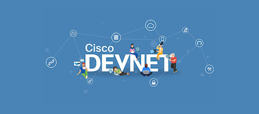

 
Cisco DevNet, found at [developer.cisco.com](https://developer.cisco.com), is Cisco’s developer program to help developers and IT professionals who want to write applications and develop integrations with Cisco products, platforms, and APIs. Cisco DevNet includes Cisco’s products in software-defined networking, security, cloud, data center, Internet of Things, collaboration, and Cisco customer experience. The [developer.cisco.com](https://developer.cisco.com) site also provides [docs](https://developer.cisco.com/docs), [tutorials](https://developer.cisco.com/learning), [code examples](https://developer.cisco.com/codeexchange/), and [sandbox environments](https://developer.cisco.com/site/sandbox) as well as video series to learn coding and testing apps.

  

- Developer Blogs [https://blogs.cisco.com/developer](https://blogs.cisco.com/developer)

- If you have a GitHub-related request, don't hesitate to get in touch with **devnet-github-owners@cisco.com** with a description of your request.

- Join DevNet to get the tools, resources, and code to build network-enabled solutions https://developer.cisco.com/join/devnet/

<h3 align="left">Connect with DevNet:</h3>

<table><tr>
<td align="center"></td>
<td align="center"></td>
<td align="center"></td>
<td align="center"></td>
<td align="center"></td>
<td align="center"></td>
<td align="center"></td>
</tr></table>

<h3 align="left">Languages and Tools:</h3>

<table><tr>
<td align="center"></td>
<td align="center"></td>
<td align="center"></td>
<td align="center"></td>
<td align="center"></td>
<td align="center"></td>
<td align="center"></td>
<td align="center"></td>
<td align="center"></td>
<td align="center"></td>
<td align="center"></td>
</tr></table>

# Latest YouTube Videos
<!-- YOUTUBE:START -->
- [DevNet Month of CVDs | Ep.2: Cisco Validated Designs Meet Ansible](https://www.youtube.com/watch?v=uEzVZILs6K0)
- [Post-Quantum Cryptography in the Real World - Part 2 | Ep. 122](https://www.youtube.com/watch?v=KvxxdaTgzDU)
- [DevNet Month of CVDs | Ep.1: Intro to Cisco Validated Designs](https://www.youtube.com/watch?v=uqyEqMSjVK0)
- [Data Centre AIOps using Nexus MCP &amp; Cisco Cloud Control | Ep.121](https://www.youtube.com/watch?v=x1pueBW1mjk)
- [DevNet Sandboxes, Rebuilt](https://www.youtube.com/watch?v=eG-D11GCChI)
<!-- YOUTUBE:END -->

# Latest Blog posts
<!-- BLOG-POST-LIST:START -->
- [Rebuilding PubHub: A Cautionary Tale of AI-Driven Requirements, Part 4](https://blogs.cisco.com/cisco-devnet/ai-driven-requirements-rebuilding-pubhub-part-4/)
- [Welcome to the DevNet Month of Cisco Validated Designs](https://blogs.cisco.com/cisco-devnet/welcome-to-the-devnet-month-of-cisco-validated-designs/)
- [CodeGuard: Teaching your AI coding assistant to never write that bug again – Security Loop Series, Part 3](https://blogs.cisco.com/cisco-devnet/codeguard-ai-coding-assistant-security-rules-part-3/)
- [Mastering stateful stream reordering at 200,000 messages per second](https://blogs.cisco.com/cisco-devnet/flink-ab-development-stateful-stream-processing/)
- [Design-to-Code: Reimagine Handoff Workflow with AI – Rebuilding PubHub Part 3](https://blogs.cisco.com/cisco-devnet/design-to-code-ai-handoff-workflow/)
<!-- BLOG-POST-LIST:END -->
